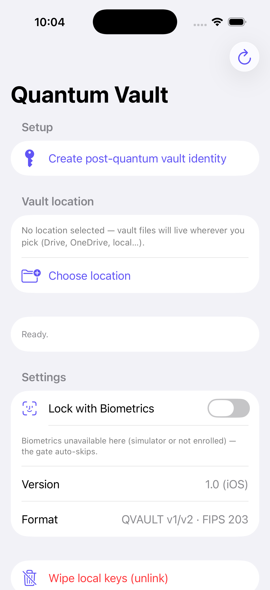

# Quantum Vault — iOS 🔐

**Your files, sealed before they ever leave your hands.** The iOS counterpart of
[Quantum-Vault (Android)](https://github.com/bamit99/Quantum-Vault): on-device
post-quantum encryption with NIST-standardized **ML-KEM-768**, stored via the
system Files picker into any folder you choose — Google Drive, OneDrive, local.
**No OAuth. No cloud SDK. No account.** The vault travels with your files.

> **Platform:** iOS 26+ (CryptoKit's native ML-KEM requires iOS 26; older versions
> are not supported by this port).
> © 2026 [Amit Bhatnagar](https://www.linkedin.com/in/amitxbhatnagar/) — free for
> personal use; commercial use requires prior permission. See [LICENSE.md](LICENSE.md).



## Why "Quantum"?

Every encrypted file stored in the cloud today can be **harvested now and
decrypted later**: a future quantum computer running Shor's algorithm breaks
today's RSA/ECDH key exchange retroactively. Quantum Vault defends against that
*today* by wrapping every file key with **ML-KEM-768 (FIPS 203)** combined with
**X25519** in a hybrid construction — an attacker must break *both* legs.

## Crypto architecture

| Layer | Primitive | Role |
|---|---|---|
| Key encapsulation | **ML-KEM-768** (FIPS 203, CryptoKit) | Post-quantum wrap of the file key |
| Key encapsulation | **X25519** | Classical wrap of the file key (hybrid belt-and-braces) |
| Key derivation | **HKDF-SHA256** (`"aiguru-pq-hybrid-v1"`) | Combines both shared secrets → KEK |
| KDF (passphrase) | **Argon2id** (t=3, 64 MiB, p=1) | Passphrase → wrapping key; GPU-hostile |
| Payload | **AES-256-GCM** (128-bit tag) | File content encryption |
| Device binding | **iOS Keychain** (`WhenUnlockedThisDeviceOnly`) | Vault private keys stay on-device |
| Escrow | **`.vaultkey`** in the vault folder | Passphrase-wrapped PQ keys — survives phone loss |

**QVAULT container format** — every encrypted file is a `QVAULT`-magic container
(v1: device-wrap; v2: *dual-wrap* — the random file key is wrapped once under
the device PQ keys and once under `Argon2id(passphrase)`. **Either factor alone
unwraps.**) The iOS engine is **byte-compatible** with the Android app: the same
`.qvault` files decrypt on both platforms.

## Cross-platform compatibility — proven by tests

The test suite contains vectors generated by the **Android stack**
(BouncyCastle 1.85, identical constants and container assembly):

- ✅ Android-encrypted QVAULT v1 blob → decrypted by the iOS engine
- ✅ Android-encrypted QVAULT v2 (dual-wrap) blob → decrypted by iOS, **both
  the device leg and the passphrase leg**
- ✅ Android-written `.vaultkey` escrow (seed format) → restored on iOS →
  decrypts Android-encrypted files
- ✅ iOS-written escrow → restorable on Android (BouncyCastle auto-detects the
  64-byte seed form)
- ⚠️ Android's *expanded*-format escrow (2400 B) cannot be imported into
  CryptoKit — Android's escrow export should use the seed form
  (`getSeed()` instead of `getEncoded()`) for full symmetry

Interoperability was verified with deterministic JVM vector generators
([Tests/QVaultVectorGen.java](Tests/QVaultVectorGen.java),
[Tests/QVaultVectorGenV2.java](Tests/QVaultVectorGenV2.java),
[Tests/QVaultEscrowVectorGen.java](Tests/QVaultEscrowVectorGen.java)) that use
the exact same wire format and KDF parameters as the Android app.

## App features (Phase 1–3)

- Vault identity: ML-KEM-768 + X25519 keypair, persisted in the Keychain
- Vault location via the Files picker with security-scoped bookmarks — the
  iOS analogue of Android's SAF `ACTION_OPEN_DOCUMENT_TREE` flow
- Encrypt any file → `<name>.qvault` in the vault folder; browse, decrypt
  (share sheet), delete
- Dual-wrap (v2) encryption with an optional passphrase per file
- `.vaultkey` escrow: save to vault folder / restore on a fresh install
- Face ID / Touch ID session gate (graceful fallback where unavailable)
- Two-tier key wipe: unlink (device keys only; files + escrow stay) — the
  typed-DESTROY tier is on the roadmap

## Project structure

```
├── Package.swift               # QVaultCrypto Swift package (crypto engine)
├── Sources/QVaultCrypto/       # HybridPQCrypto, PassphraseKDF, AESGCM, Escrow
│   └── Cargon2/                # Vendored Argon2 C reference implementation
├── Tests/                      # XCTest suite + JVM vector generators (Java)
└── app/
    ├── project.yml             # xcodegen manifest (source of truth for the project)
    ├── QuantumVault.xcodeproj  # generated — commit includes it for clone-and-open
    └── Sources/                # SwiftUI app: VaultModel, ContentView, BiometricGate…
```

## Building & testing

**Run the crypto test suite (17 tests):**

```bash
swift test
```

**Open the app in Xcode** (requires iOS 26.x simulator runtime):

```bash
open app/QuantumVault.xcodeproj
# select the iPhone simulator, Cmd+R
```

**Regenerate the Xcode project from the manifest** (optional, [xcodegen](https://github.com/yonaskolb/XcodeGen)):

```bash
cd app && xcodegen generate
```

**Regenerate cross-platform test vectors** (requires Java + BouncyCastle
`bcprov-jdk18on-1.85.jar`):

```bash
cd Tests
javac -cp /path/to/bcprov.jar QVaultVectorGen.java
java  -cp .:/path/to/bcprov.jar QVaultVectorGen
```

## Status

- ✅ Phase 1 — crypto engine, byte-compatible QVAULT v1/v2, Argon2id, cross-platform decrypt proof
- ✅ Phase 2 — SwiftUI app, Files integration, escrow save/restore
- ✅ Phase 3 — Face ID gate, settings, export-compliance metadata
- 🔜 Roadmap: real-device testing, release signing, App Store packaging

See the Android repo's [SECURITY_AUDIT.md](https://github.com/bamit99/Quantum-Vault/blob/master/SECURITY_AUDIT.md)
for the published security audit of the shared crypto design.

## License

Free for personal use; commercial use requires prior written permission —
see [LICENSE.md](LICENSE.md).